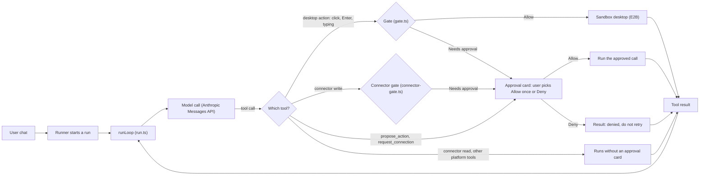

# Dobot

Dobot is an AI coworker prototype: a bot works on its own visible remote computer and stops for human approval before actions with side effects, within the gaps listed under [Known limitations](#known-limitations).

Author: Robert Anton. Built with Claude Code and Codex.

> This is a one-commit snapshot of a private repository with 396 commits made with Claude Code
> and Codex. The full history is available on request.

## What it does

Dobot runs AI agents ("bots") that each have a persistent identity, memory and a remote Linux
desktop. A user describes a job in chat. The bot does the work, and the user can watch its desktop
steps live; steps done through a connector appear in the chat and the Runs tab. The bot saves
repeatable procedures as skills and runs them on a schedule or when mail arrives. Actions with
external side effects, such as sending, submitting or booking, stop for the user's approval,
within the known gaps listed under [Known limitations](#known-limitations).

Dobot is inspired by Grok Bot. It is a working proof of concept and is being developed into a
hosted service for teams in the EU.

## Why this is interesting

- **Agent loop with tool calling.** `runLoop` in `src/server/agent/run.ts` calls the model, runs
  each tool call and feeds the result back. It has a step budget, stuck detection and recovery
  after a restart. There is no agent framework, so the approval gate sits exactly
  between the model's tool call and its execution.
- **An approval gate enforced in code, independent of the model.** Browser actions are checked in
  `src/server/agent/gate.ts`. Connector writes are checked in `src/server/agent/connector-gate.ts`.
  Neither check depends on what the model says; the known gaps are listed under
  [Known limitations](#known-limitations). Fail closed: when an allow rule and an approval rule
  both match, approval is required.
- **Reviewer agents and hooks for both Claude Code and Codex.** The same six review roles, the
  workflow skills and a session-start hook exist for both tools. See `.claude/`, `.codex/` and
  `.agents/`.
- **Preflight greps that enforce a platform boundary.** `scripts/preflight.sh` fails if code
  under `src/` names a site, uses the words of one bot's job, holds a date or tells the story of
  a past review. The platform stays independent of any single bot.
- **A verification record that states its limits.** `docs/verification.md` lists what was tested
  in live runs, what failed, and a section called "What this does not establish".

## Read these 5 files first

1. [`src/server/agent/run.ts`](src/server/agent/run.ts): the agent loop and where the gate is applied to each tool call.
2. [`src/server/agent/gate.ts`](src/server/agent/gate.ts): approval rules for browser actions, one-shot approvals and the secret guard.
3. [`src/server/agent/connector-gate.ts`](src/server/agent/connector-gate.ts): connector reads run; connector writes always wait for an approval card.
4. [`scripts/preflight.sh`](scripts/preflight.sh): typecheck, tests and the greps that keep the platform boundary.
5. [`docs/verification.md`](docs/verification.md): what was tested, with costs, and what remains unproven.

## How one run works



Other platform tools include saving memory and files, and `attach_file`, which checks its target
before it clicks. The bot saves memory and files on purpose; a result is not saved automatically.
Every step is written to the run log.

## Proof

- **Tests:** 900 tests in 44 files (`pnpm test`, Vitest) and 16 Python tests for the in-sandbox
  companion. `pnpm typecheck` and `pnpm preflight` pass.
- **CI:** [`.github/workflows/ci.yml`](.github/workflows/ci.yml) runs typecheck, tests, the
  companion tests and the platform-boundary greps on every push and pull request. A second job
  runs Semgrep. See [docs/semgrep.md](docs/semgrep.md) for what ran and what it found.
- **Evidence:** [docs/evidence/](docs/evidence/) holds dated records of live runs, probes and
  measurements, including failures. The guide to them is in
  [docs/README.md](docs/README.md#evidence-worth-keeping).
- **Not here yet:** no evals, no LLM-as-judge, no hosted deployment.

## Table of contents

- [What it does](#what-it-does)
- [Why this is interesting](#why-this-is-interesting)
- [Read these 5 files first](#read-these-5-files-first)
- [How one run works](#how-one-run-works)
- [Proof](#proof)
- [Features](#features)
- [Status](#status)
- [Requirements](#requirements)
- [Installation](#installation)
- [Configuration](#configuration)
- [Usage](#usage)
- [Example bots](#example-bots)
- [Architecture](#architecture)
- [Project structure](#project-structure)
- [Development](#development)
- [Known limitations](#known-limitations)
- [Roadmap](#roadmap)
- [Documentation](#documentation)
- [License](#license)

## Features

- **Live remote computer.** Each bot has its own E2B desktop sandbox. The user sees the screen
  while the bot works.
- **Approval gate.** Connector writes always stop for **Allow once** or **Deny**. Browser
  actions such as sends, submissions and bookings are checked in code by the server,
  independently of the model, with the known gaps described under
  [Known limitations](#known-limitations). When an allow rule and an approval rule both match,
  approval is required.
- **Takeover.** For passwords, two-factor codes and CAPTCHAs, the user takes control of the
  remote screen, completes the step and hands control back. This keeps passwords out of the
  chat and the normal model input. The hand-back check has frame and restart limits, described
  under [Known limitations](#known-limitations).
- **Persistence.** Chat, memory, skills, routines and artifacts survive page reloads and server
  restarts. Idle sandboxes are paused and resumed on demand.
- **Configuration through chat.** The bot writes its own skills and routines from the
  conversation. The user reads and corrects them in the UI.
- **Triggers.** Routines run on a cron schedule or when new mail arrives in a watched mailbox.
- **Connectors.** Built-in connectors (mailbox, maps) let a bot use an API instead of the
  browser when one covers the step.
- **Run traces and cost controls.** The **Runs** tab shows each action and result. A daily
  model budget is checked before each run.

## Status

Proof of concept. It runs for one local operator on one machine. It has no user login, no
multi-user isolation and no durable execution. Do not expose it to a network. See
[Known limitations](#known-limitations).

## Requirements

- Node.js 24 or later
- pnpm 12 (the exact version is pinned in `package.json`)
- An [E2B](https://e2b.dev) API key
- An [Anthropic](https://console.anthropic.com) API key with credit
- Python 3, only to run the companion tests locally

## Installation

```bash
git clone https://github.com/robertanton81/dobot-public.git dobot
cd dobot
pnpm install --frozen-lockfile
cp .env.example .env.local
```

If pnpm is missing, install it with `npm install -g pnpm@12`. The lockfile is committed, so
`pnpm install --frozen-lockfile` reproduces the tested dependency versions. Running the app
needs your own E2B and Anthropic API keys (see Configuration). Tests and the preflight checks need
no keys and no network.

## Configuration

Settings are read from `.env.local`, which Git ignores. Set these two values:

| Variable | Purpose |
| --- | --- |
| `E2B_API_KEY` | Creates and controls the remote desktops. |
| `ANTHROPIC_API_KEY` | Model calls. |

The other values in `.env.example` have working defaults:

| Variable | Default and purpose |
| --- | --- |
| `MODEL_ID` | The Anthropic model used by the agent loop. |
| `E2B_DOMAIN` | Empty for E2B's default cluster. Set it for a custom cluster, such as the EU cluster. |
| `TZ` | Time zone for schedules and the daily budget. |
| `DAILY_BUDGET_USD` | `25`. Checked before each run; computer costs are not included. |
| `ROUTINE_MIN_INTERVAL_MINUTES` | `15`. The shortest allowed routine interval. |
| `BLOCKED_HOLD_MINUTES` | `30`. How long a blocked computer stays awake while it waits for a person. |

Mail triggers, attention notices and connectors are optional. They are described in the
[operating guide](docs/operating-guide.md#mail-and-attention-notices).

Never put keys or passwords into a bot's chat.

## Usage

Start the development server:

```bash
pnpm dev
```

1. Open <http://localhost:5173>.
2. Choose **New bot**. Give it a name and a short job description.
3. Give it a first task, for example:

   > Open https://example.com in your browser, take a screenshot, and tell me the page heading.

4. After a successful run, ask the bot to save the procedure as a skill. You can also ask for a
   recurring routine.

To run the production build on <http://localhost:3000>:

```bash
pnpm build
pnpm start
```

Model calls and E2B sandbox time are billed by those providers. Measured model costs per run
were about $0.05 for a short task, about $0.30 for a calendar booking and $0.70 to $1.50 for
preparing a job application. Longer research tasks cost more. These figures are measurements,
not price guarantees.

## Example bots

One example bot is included. It runs on the same platform code as every bot; its job-specific
instructions live in skills, not in `src/`.

- **Homer** (`examples/homer/`) is the portable example. The original Homer learned its skill
  through chat, searched two property sites, researched the surrounding towns and wrote
  reports. The portable copy limits a new search to two houses and has not had a new live run.

To load Homer, stop the server and copy the template:

```bash
mkdir -p data/bots
test -e data/bots/homer || cp -r examples/homer data/bots/homer
pnpm dev
```

Then select **Homer** in the app. An existing `data/bots/homer/` is left unchanged. The template
includes the learned skill and sample preferences. It does not include chat
history, credentials or a browser session. A new remote computer is created when needed, and no
routine starts automatically. See [Use the example bot](docs/operating-guide.md#use-the-example-bot)
for the full workflow.

## Architecture

```text
Browser (React + Vite)
   |  REST + one SSE stream per bot
Node.js process (Hono)
   |-- agent loop and approval gate
   |-- scheduler (croner) and mail watcher (IMAP)
   |-- file store: data/bots/<id>/
   |
   |-- Anthropic Messages API (computer use tools)
   |-- E2B Desktop Sandbox, one per bot
          |-- Chrome, controlled through the screen
          |-- Python companion: inspects browser controls over CDP and attaches files
```

- **One process.** API, server-sent events, static files, scheduler and agent loop run in one
  long-running Node.js process. There is no serverless part.
- **No agent framework.** The approval gate sits between the model's tool call and its
  execution. Agent frameworks place their own loop at that point.
- **No database.** Each bot is a folder of files. A database can replace the store behind its
  existing interface when transactions or several workers are needed.

E2B Surf was studied for its screen integration. It was not forked. The design decisions,
trade-offs and reused components are recorded in [docs/decisions.md](docs/decisions.md).

## Project structure

| Path | Contents |
| --- | --- |
| `src/server/` | Hono server: API, SSE, scheduler, agent loop, approval gate, sandbox layer, file store |
| `src/server/companion/` | Python companion that runs inside the sandbox, and its TypeScript client |
| `src/server/connectors/` | Built-in connectors |
| `src/web/` | React UI: bot list, chat, live screen, approval cards, Skills and Runs tabs |
| `examples/` | Bot templates |
| `docs/` | Operating guide, decisions, verification records, specs and plans |
| `scripts/` | Preflight checks and setup scripts |
| `data/bots/` | Local bot state, ignored by Git |

## Development

```bash
pnpm typecheck   # tsc --noEmit
pnpm test        # vitest run
pnpm preflight   # typecheck, tests and platform-boundary checks
```

`pnpm preflight` must pass before a change is merged, and CI runs the same checks. It also checks that no code under
`src/` contains task-specific wording, so the platform stays independent of any single bot.
The companion tests need Python 3; preflight reports when it skips them.

The development workflow (specs, plans, implementation and review) is described in
[.claude/README.md](.claude/README.md).

## Known limitations

- **No durable execution.** A run cannot resume from the step where it stopped after a crash or
  restart. Recovery closes unfinished runs and pending approval cards. If an approved action may
  have happened, its result is reported as unknown.
- **Local file storage.** State lives in `data/bots/<id>/`, with no database, no transactions
  across files and no replication. Writes are coordinated inside one process only. Back up
  `data/` separately.
- **Model-dependent memory.** A new run receives the full memory and skills plus up to six
  recent chat messages. A constraint that the bot never writes down can be lost.
- **Single operator.** There is no login and no multi-user isolation. Scheduled work needs the
  server to run.
- **Approval gaps.** Prompt injection from page or mail text is not fully prevented. Action
  links and some keyboard shortcuts can bypass the approval gate. The browser checks can miss a
  control. See [approval signals](docs/decisions.md#two-approval-signals-and-no-always-allow-button).
- **Takeover limits.** The hand-back check cannot inspect closed shadow roots or cross-origin
  frames. A hand-back requirement does not survive a restart or a sleeping computer. See
  [screen controls](docs/operating-guide.md#screen-controls-and-approvals).
- **Cost of long tasks.** Page text accumulates during a run. Step and model-call limits can
  stop a run before it saves a report. The daily budget is checked before a run starts, so it
  is not a hard spending cap.
- **One shared mailbox.** The server watches one mailbox, not one per bot. Attention notices are
  sent once, without retry.
- **Remote state.** Replacing a bot's computer requires signing in again. Files kept only on the
  remote computer are not backed up.

## Roadmap

Planned work, not current features. The reasoning is in
[docs/decisions.md](docs/decisions.md#what-i-would-build-next).

- Durable execution: workflow checkpoints, a persistent queue, and reconciliation of uncertain
  external actions before a retry.
- Structured task progress and partial results saved before limits are reached.
- Labelled test cases from reviewed runs, to measure output quality without a live computer.
- Scoped, revocable "always allow" permissions per bot, action, site and recipient.
- One mailbox per bot, plus calendar and webhook triggers.
- Remaining setup in the product: persona edits in chat, archiving a bot, and a masked form
  for mailbox credentials.

## Documentation

- [Operating guide](docs/operating-guide.md): configuration, recovery and runtime limits
- [Decisions](docs/decisions.md): design choices, trade-offs and reused components
- [Verification](docs/verification.md): what was tested in live runs and what is unproven
- [Documentation index](docs/README.md)

## License

Source-available for evaluation. All rights reserved by the author. No license is granted to use, copy or modify this code.

Third-party files keep their own licenses. For example, `.agents/skills/typesafe-ai/` is under the MIT license in its own `LICENSE` file.
